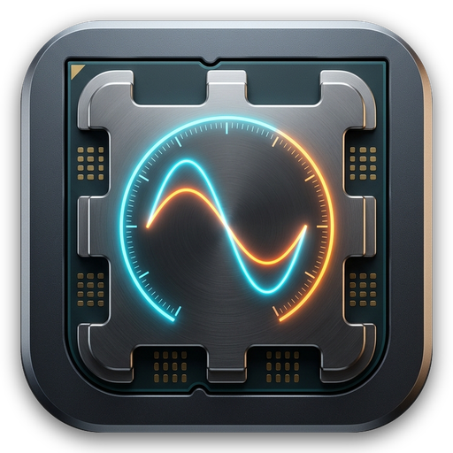
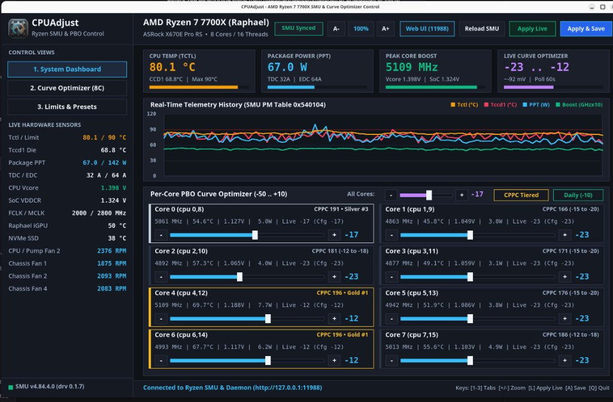
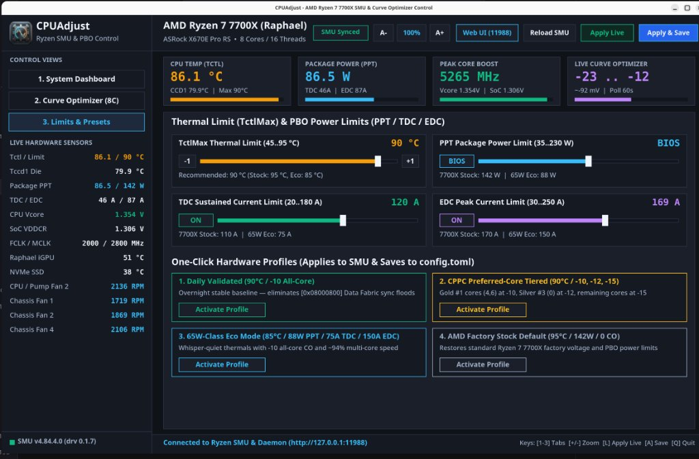

#  CPUAdjust (`cpu-adjust`)

**AMD Ryzen 7000 (*Raphael* / Zen 4) SMU Curve Optimizer, PBO Power & Thermal Limit Daemon, CLI, Native X11 Vector GUI, CoolerControl-Style Web UI, and Interactive TUI.**

[](LICENSE)

---

## ⚠️ Hardware & Liability Disclaimer

> **USE AT YOUR OWN RISK.**
>
> `cpu-adjust` writes directly to AMD System Management Unit (SMU) hardware mailboxes (`RSMU` and `MP1`), Precision Boost Overdrive (PBO) Curve Optimizer DLDO PSM voltage registers, package power/current limits (`PPT`, `TDC`, `EDC`, `TDC_SOC`, `EDC_SOC`), PBO FIT reliability scalars, thermal limits (`TctlMax`), `amd_pstate` frequency scaling interfaces, and `amdgpu` Dynamic Power Management (DPM) states.
>
> - **Risk of Instability, Data Loss, or Hardware Damage**: Undervolting, overclocking, raising current/power limits, increasing PBO FIT scalars, or altering thermal limits beyond AMD factory specifications can cause immediate system crashes, silent data corruption, Wheeler Hardware Error Architecture (WHEA) faults, accelerated silicon degradation, or permanent damage to your processor, motherboard, or power delivery components.
> - **Warranty Notice**: Operating an AMD processor outside official specifications or using Precision Boost Overdrive / Curve Optimizer may void hardware warranties offered by AMD or your system/motherboard manufacturer.
> - **No Warranty & Non-Affiliation**: This software is provided **"AS IS"**, without warranty of any kind, express or implied, under the terms of the GNU General Public License v2.0. The authors and contributors shall not be liable for any damages or losses arising from its use. This project is an independent utility and is **not** affiliated with, endorsed by, or sponsored by Advanced Micro Devices, Inc. (AMD).

---

## Screenshots

### 1. System Dashboard — Real-Time Telemetry & Per-Core Curve Optimizer


### 2. Thermal Limits, PBO Power/Current Controls & Hardware Presets


---

## Overview & Capabilities

`cpu-adjust` interfaces with `/sys/kernel/ryzen_smu_drv/`, `/sys/devices/system/cpu/amd_pstate/`, `/sys/devices/system/cpu/cpufreq/policy*/`, `/sys/class/drm/card*/device/`, and `/sys/class/hwmon/` (`k10temp`, `nct6799`, `amdgpu`, `spd5118`, `nvme`):

1. **Dynamic CPU Topology & Core Count Detection**: Automatically detects physical core count, SMT sibling thread mapping, and CPPC Preferred Core (`highest_perf`) silicon rankings at startup (`detect_num_cores()`).
2. **Per-Core & All-Core PBO Curve Optimizer**: Real-time read/write access to per-core DLDO PSM voltage margins (`RSMU 0x06` / `MP1 0x35` / readback `RSMU 0xD5`) without rebooting into UEFI/BIOS.
3. **Thermal & Package Power Limits**: Live control over `TctlMax` (`RSMU 0x59` / `MP1 0x3F`), `PPT` (`RSMU 0x56` / `MP1 0x3C`), `TDC_VDD` (`RSMU 0x57` / `MP1 0x3D`), and `EDC_VDD` (`RSMU 0x58` / `MP1 0x3E`).
4. **Dedicated Hardware Sub-Panels with Active/Inactive Detection & Setup Guides**:
   - **1. System Dashboard**: Rolling 1.5s telemetry chart (`Tctl`, `Tccd1`, `PPT`, Peak Core Clock) + per-core Curve Optimizer sliders and all-core quick controls.
   - **2. Limits & Presets**: Interactive `TctlMax`, `PPT`, `TDC`, and `EDC` sliders with BIOS-default toggles and one-click presets (`daily`, `cppc_tiered`, `eco_88w`, `stock`).
   - **3. AMD P-State & CPPC**: Energy Performance Preference (`performance`, `balance_performance`, `balance_power`, `power`), CPUFreq governor (`powersave`, `performance`), live min/max frequency caps (`scaling_min_freq`, `scaling_max_freq`), Core Performance Boost (`boost`), and Dynamic EPP (`dynamic_epp`).
   - **4. SMU Advanced & SoC**: Integrated RDNA2 iGPU Curve Optimizer (`RSMU 0x08` / `0xD6`), SoC rail current limits (`TDC_SOC 0x6B`, `EDC_SOC 0x6C`), PBO FIT Scalar (`RSMU 0x5E` / `0x6D`, `1x–10x`), PROCHOT deassertion ramp time (`RSMU 0x5A`), and coupled DDR5 (`FCLK : UCLK : MCLK`) fabric telemetry.
   - **5. Raphael iGPU (DPM)**: `amdgpu` Dynamic Power Management performance level selector (`auto`, `low`, `high`, `profile_standard`, `profile_min_sclk`, `profile_min_mclk`, `profile_peak`), SCLK/FCLK DPM state tables, GPU load, temperature, power, VDDGFX, and VRAM/GTT usage.
   - **Built-in Enablement Instruction Pages**: Every sub-panel automatically detects whether its kernel driver/interface is active via the `HardwareSubsystem` trait. If a subsystem is inactive or not installed (or when clicking `? Setup Guide`), the UI renders a step-by-step enablement and installation guide.

---

## Architecture (SOLID Modular Design)

The codebase is organized into focused modules adhering to Single Responsibility, Open/Closed, Interface Segregation, and Dependency Inversion principles:

```text
├── src/
│   ├── main.rs                    # CLI entrypoint, subcommand router, and background monitoring daemon
│   ├── config.rs                  # Atomic TOML configuration parser, serializer, and preset definitions
│   ├── smu/                       # Hardware abstraction layer & HardwareSubsystem trait implementations
│   │   ├── mod.rs                 # HardwareSubsystem trait, RyzenSmu mailbox client (RSMU, MP1 & SMN), flock sync
│   │   ├── topology.rs            # Dynamic startup CPU core topology & CPPC preferred-core rankings
│   │   ├── board_sensors.rs       # Motherboard hwmon sensor scanner (k10temp, NCT6798D, NVMe, DDR5 SPD5118)
│   │   ├── pm_table.rs            # Raphael PM Table (0x00540104) decoder & SmuAdvancedTelemetry
│   │   ├── pstate.rs              # AMD P-State & CPPC sysfs reader/controller (AmdPstateTelemetry)
│   │   └── igpu.rs                # AMD Raphael RDNA2 iGPU DPM sysfs reader/controller (IgpuTelemetry)
│   ├── server/                    # Embedded HTTP daemon & wire protocol serialization
│   │   ├── mod.rs                 # DaemonSharedState, BackendClient, HTTP listener, and REST API routes
│   │   └── protocol.rs            # JSON & key-value wire format serializers/parsers
│   ├── gui/                       # Native X11 + Cairo vector desktop GUI
│   │   ├── mod.rs                 # X11 window lifecycle, HiDPI auto-scaling, event loop & layout test suite
│   │   ├── canvas.rs              # 2D ARGB framebuffer primitives & Cairo anti-aliased text rendering
│   │   ├── state.rs               # ActiveTab, UiAction, ClickRegion & NativeGuiState state machine
│   │   └── panels/                # GuiSubPanel trait & dedicated sub-panel view renderers
│   │       ├── mod.rs             # GuiSubPanel trait, sidebar/header/KPI chrome, & active tab dispatcher
│   │       ├── dashboard.rs       # System Dashboard (live telemetry chart & dynamic per-core Curve Optimizer)
│   │       ├── limits.rs          # Thermal Limit (TctlMax), PBO Power Limits (PPT/TDC/EDC), & Presets
│   │       ├── pstate.rs          # AMD P-State & CPPC (EPP, Governor, Frequency Caps, Boost, Prefcore)
│   │       ├── smu_advanced.rs    # SMU Advanced Controls (iGPU CO, PBO Scalar, SoC TDC/EDC, PROCHOT, DDR5)
│   │       ├── igpu.rs            # Raphael RDNA2 iGPU DPM Performance Levels & VRAM/GTT Telemetry
│   │       └── instructions.rs    # HardwareSubsystem enablement & setup guide page when inactive
│   ├── web_ui.rs                  # Embedded CoolerControl-style dark Web UI (http://127.0.0.1:11988/)
│   └── tui.rs                     # Interactive keyboard-driven terminal UI dashboard
├── driver/ryzen_smu/              # Vendored ryzen_smu v0.1.7 Linux kernel module
├── assets/                        # Application icons & GUI screenshots
├── systemd/                       # Systemd service unit (cpu-adjust.service) & desktop launcher
├── config.toml                    # Persistent hardware configuration applied at boot
└── LICENSE                        # GNU General Public License v2.0 (GPL-2.0-only)
```

---

## Front-End & GUI Usage

```bash
# 1. Launch the Native Rust X11 Desktop GUI (connects to daemon on 127.0.0.1:11988; no sudo required)
#    Automatically detects Xft.dpi and 4K/6K HiDPI screen geometry; use A-/100%/A+ or +/-/0 keys to zoom live.
cpu-adjust gui
# or with an explicit display scale factor (e.g. 2.0x):
cpu-adjust gui --scale 2.0

# 2. Launch the CoolerControl-style Web Dashboard in a standalone chromeless desktop window
cpu-adjust gui --web
# or open http://127.0.0.1:11988 in any browser

# 3. Launch the Interactive Terminal UI (for terminal / SSH sessions)
cpu-adjust tui
```

---

## CLI Usage

```bash
# View live SMU Curve Optimizer offsets, PM Table power/voltages, CPPC rankings, P-State, and iGPU status
cpu-adjust status

# Activate a hardware preset and save to config.toml:
#   daily       -> 90°C TctlMax, -10 all-core CO
#   cppc_tiered -> 90°C TctlMax, Gold #1 cores -10, Silver #3 core -12, remaining cores -15
#   eco_88w     -> 85°C TctlMax, 88W PPT / 75A TDC / 150A EDC, -10 all-core CO
#   stock       -> 95°C TctlMax, 142W PPT / 110A TDC / 170A EDC, 0 all-core CO
cpu-adjust preset cppc_tiered
cpu-adjust preset daily

# Set all cores to -10 and update config.toml
cpu-adjust set-all -10

# Set a single physical core's CO offset (e.g. Core 1 to -15) and save
cpu-adjust set-core 1 -15

# Set all physical cores individually and save
cpu-adjust set-cores -17,-23,-23,-23,-12,-23,-12,-23

# Set thermal limit (TctlMax) to 90°C and save
cpu-adjust set-temp 90

# Configure AMD P-State Energy Performance Preference (EPP)
cpu-adjust set-epp balance_performance

# Configure Raphael RDNA2 iGPU DPM performance level
cpu-adjust set-igpu-dpm auto

# Configure SMU Advanced parameters (iGPU CO, SoC current limits, PBO FIT scalar)
cpu-adjust set-gfx-co -10
cpu-adjust set-soc-limits 30 45
cpu-adjust set-scalar 1
```

---

## Building & Testing

```bash
# Build optimized release binary
cargo build --release

# Run unit & multi-resolution GUI layout verification tests
cargo test

# Manage background systemd service
sudo systemctl status cpu-adjust.service
sudo journalctl -u cpu-adjust.service -f
```

---

## License & Attribution

This project is licensed under the **GNU General Public License v2.0 only (`GPL-2.0-only`)** — see the [`LICENSE`](LICENSE) file for full details.

- **Included Kernel Module (`driver/ryzen_smu/`)**: Based on [`ryzen_smu`](https://github.com/leogx9r/ryzen_smu) / [`amkillam/ryzen_smu`](https://github.com/amkillam/ryzen_smu), Copyright (C) 2020 Leonardo Gates (`leogx9r`) and contributors, licensed under the **GNU General Public License v2.0 (`GPL-2.0-only`)** (see [`driver/ryzen_smu/LICENSE`](driver/ryzen_smu/LICENSE)).
- **Optional Userspace Reference Library (`driver/ryzen_smu/lib/`)**: Copyright (C) 2020 Leonardo Gates (`leogx9r`), licensed under the **GNU Lesser General Public License v3.0 or later (`LGPL-3.0-or-later` / `GPL-3.0-or-later`)** (see [`driver/ryzen_smu/lib/LICENSE`](driver/ryzen_smu/lib/LICENSE)). Note: `cpu-adjust` does not link against `driver/ryzen_smu/lib/`; it communicates directly with `/sys/kernel/ryzen_smu_drv/` from pure Rust.

